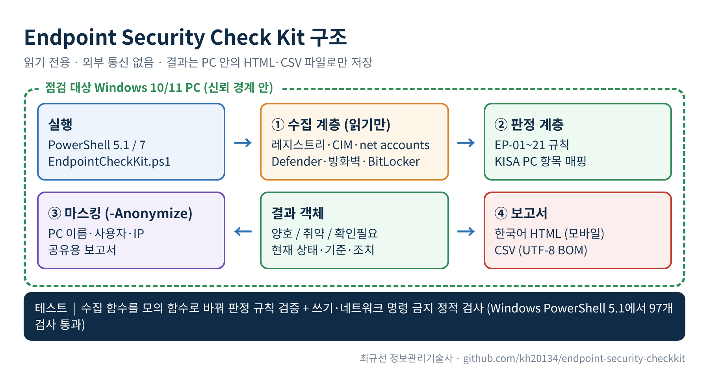
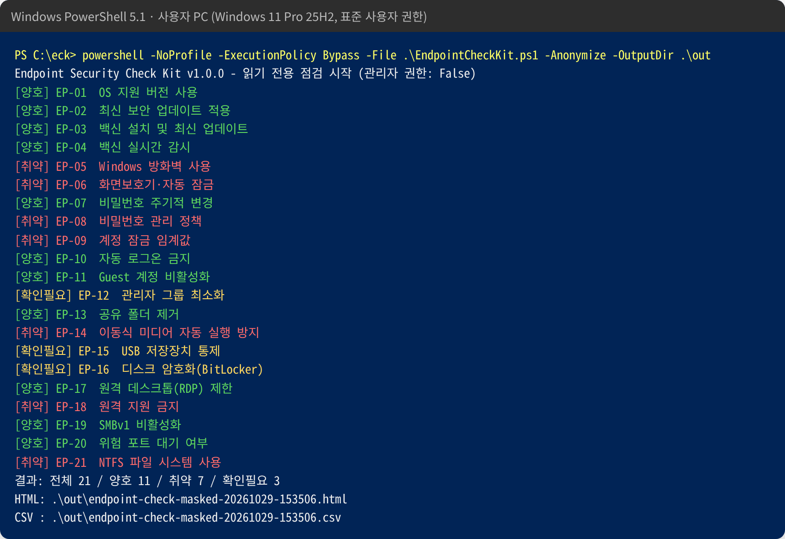
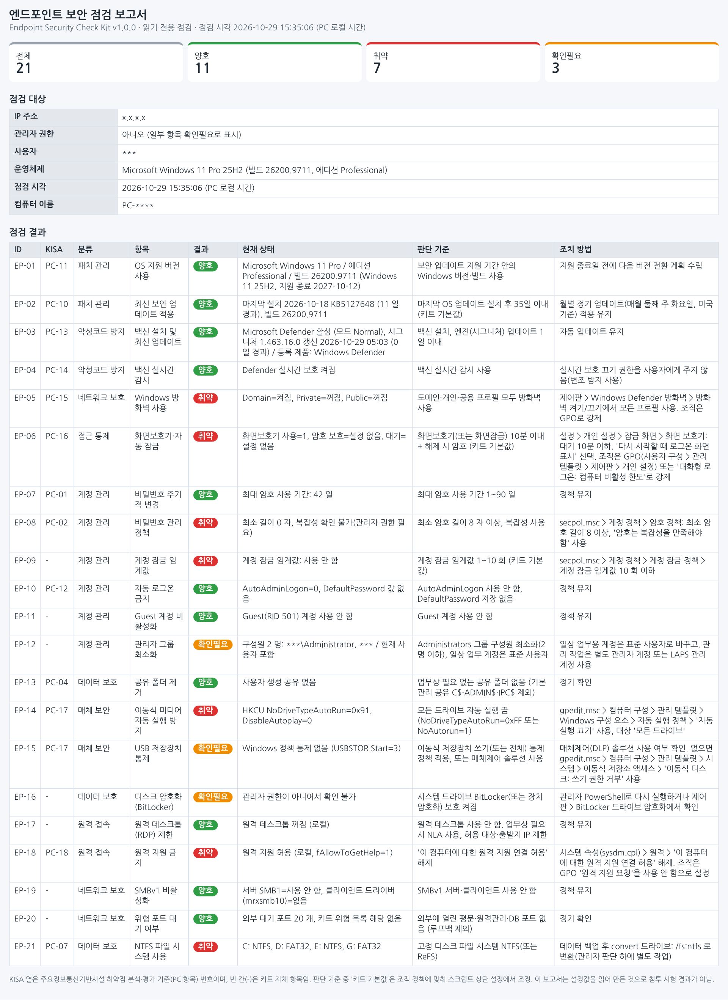

# Endpoint Security Check Kit

Windows 10/11 사용자 PC의 보안 설정을 **읽기만 해서** 점검하고, 결과를 한국어 HTML 보고서와 CSV로 남기는 PowerShell 스크립트입니다. 점검 항목 21개 가운데 14개는 KISA 「주요정보통신기반시설 기술적 취약점 분석·평가 방법 상세가이드」 PC 항목 13개(PC-xx)에 맞춰 두었고, 나머지 7개는 실무에서 자주 문제가 되는 설정을 키트 자체 항목(EP-xx)으로 더했습니다.

- 설정을 바꾸지 않습니다. 레지스트리·정책·서비스에 쓰는 명령이 없고, 테스트가 이를 검사합니다.
- 네트워크로 아무것도 보내지 않습니다. 보고서는 실행한 PC의 폴더에만 저장됩니다.
- Windows PowerShell 5.1(Windows 10/11 기본 탑재)과 PowerShell 7에서 동작합니다. 별도 모듈 설치가 필요 없습니다.

## 구조도



- 신뢰 경계는 점검 대상 PC 하나입니다. 수집 → 판정 → (선택) 마스킹 → 보고서 저장이 모두 그 PC 안에서 끝납니다.
- 수집 함수(`Get-Eck*`)와 판정 함수(`Test-Eck*`)를 나눴습니다. 테스트는 수집 함수만 모의 함수로 바꿔 판정 규칙을 검증합니다.

## 요약

| 구분 | 내용 |
|---|---|
| 대상 | Windows 10/11 (Home·Pro·Enterprise·Education) |
| 실행 | `powershell -NoProfile -ExecutionPolicy Bypass -File .\EndpointCheckKit.ps1` |
| 권한 | 표준 사용자로도 실행됩니다. BitLocker·암호 복잡성·SMB1 기능 상태는 관리자 권한일 때만 확인되고, 아니면 `확인필요`로 표시됩니다. |
| 결과 | `양호` / `취약` / `확인필요` + 현재 상태 + 판단 기준 + 조치 방법 |
| 산출물 | `EndpointCheck-Report\endpoint-check-<PC이름>-<시각>.html`, `.csv` (UTF-8 BOM, Excel에서 바로 열림) |
| 공유용 | `-Anonymize`: PC 이름·사용자 이름·IP 주소를 가린 보고서 |

## 실행 결과 예시

아래는 실제 Windows 11 Pro 25H2 PC에서 표준 사용자 권한으로 `-Anonymize`를 붙여 실행한 화면입니다(2026-10-29). PC 이름·사용자·IP는 가려져 있습니다.





보고서 원본: [docs/examples/sample-report.html](docs/examples/sample-report.html)

## 점검 항목

| ID | KISA | 분류 | 항목 | 양호 기준 (키트 기본값 포함) |
|---|---|---|---|---|
| EP-01 | PC-11 | 패치 관리 | OS 지원 버전 사용 | 에디션별 보안 업데이트 지원 기간 안의 빌드 |
| EP-02 | PC-10 | 패치 관리 | 최신 보안 업데이트 적용 | 마지막 업데이트 설치 후 35일 이내 (35~60일 확인필요, 60일 초과 취약) |
| EP-03 | PC-13 | 악성코드 방지 | 백신 설치 및 최신 업데이트 | 백신 활성 + 엔진(시그니처) 1일 이내 (7일 초과 취약) |
| EP-04 | PC-14 | 악성코드 방지 | 백신 실시간 감시 | 실시간 보호 켜짐 |
| EP-05 | PC-15 | 네트워크 보호 | Windows 방화벽 사용 | 도메인·개인·공용 프로필 모두 켜짐 |
| EP-06 | PC-16 | 접근 통제 | 화면보호기·자동 잠금 | 10분 이내 + 해제 시 암호 (또는 비활성 한도 정책 600초 이하) |
| EP-07 | PC-01 | 계정 관리 | 비밀번호 주기적 변경 | 최대 암호 사용 기간 1~90일 |
| EP-08 | PC-02 | 계정 관리 | 비밀번호 관리 정책 | 최소 길이 8자 이상 + 복잡성 사용 |
| EP-09 | - | 계정 관리 | 계정 잠금 임계값 | 1~10회 |
| EP-10 | PC-12 | 계정 관리 | 자동 로그온 금지 | AutoAdminLogon≠1, DefaultPassword 값 없음 (값 내용은 읽지 않음) |
| EP-11 | - | 계정 관리 | Guest 계정 비활성화 | RID 501 계정 사용 안 함 |
| EP-12 | - | 계정 관리 | 관리자 그룹 최소화 | Administrators 2명 이하, 현재 사용자는 표준 사용자 |
| EP-13 | PC-04 | 데이터 보호 | 공유 폴더 제거 | 기본 관리 공유(C$·ADMIN$·IPC$) 외 공유 없음 |
| EP-14 | PC-17 | 매체 보안 | 이동식 미디어 자동 실행 방지 | NoDriveTypeAutoRun=0xFF 또는 NoAutorun=1 |
| EP-15 | PC-17 | 매체 보안 | USB 저장장치 통제 | 이동식 저장소 거부 정책 또는 USBSTOR 사용 안 함 (없으면 매체제어 솔루션 확인필요) |
| EP-16 | - | 데이터 보호 | 디스크 암호화(BitLocker) | 시스템 드라이브 보호 켜짐 |
| EP-17 | - | 원격 접속 | 원격 데스크톱(RDP) 제한 | 꺼짐 (켜져 있으면 NLA 여부에 따라 확인필요/취약) |
| EP-18 | PC-18 | 원격 접속 | 원격 지원 금지 | fAllowToGetHelp=0 |
| EP-19 | - | 네트워크 보호 | SMBv1 비활성화 | 서버·클라이언트 SMB1 사용 안 함 |
| EP-20 | - | 네트워크 보호 | 위험 포트 대기 여부 | 21·23 대기 없음, DB·원격관리 포트(1433·3306·3389·5900 등)는 확인필요 (루프백 제외) |
| EP-21 | PC-07 | 데이터 보호 | NTFS 파일 시스템 사용 | 고정 디스크 NTFS/ReFS |

KISA 번호는 「주요정보통신기반시설 취약점 분석·평가 기준」 [붙임2] PC 항목 원문에서 항목명을 확인한 것만 적었습니다. 화면보호기 10분, 암호 8자·90일, 잠금 10회, 패치 35일 같은 수치는 **키트 기본값**이며 KISA 원문 수치로 표기하지 않습니다. 조직 기준에 맞춰 스크립트 상단 `$script:EckConfig`에서 바꾸면 됩니다.

## 사실 확인과 근거

| 근거 | 키트에 반영한 내용 |
|---|---|
| [주요정보통신기반시설 취약점 분석·평가 기준 [붙임2]](https://www.law.go.kr/LSW/flDownload.do?flSeq=159837655), [KISA 기술적 취약점 분석·평가 상세가이드](https://www.kisa.or.kr/2060204/form?lang_type=KO&postSeq=22) | PC-01·02·04·07·10~18 항목명과 매핑 |
| [개인정보의 안전성 확보조치 기준 (개인정보보호위원회 고시 제2025-9호)](https://www.law.go.kr/LSW/admRulInfoP.do?admRulSeq=2100000265956) | 제9조 보안 프로그램 자동 업데이트 또는 일 1회 이상 업데이트 → 시그니처 1일 기준 / 제6조 공유 설정 유출 방지, 일정 시간 후 접속 차단 / 제7조 PC·보조저장매체 저장 시 암호화 / 제10조 보조저장매체 반출·입 통제 |
| [Windows 11 release information](https://learn.microsoft.com/en-us/windows/release-health/windows11-release-information), [Windows 10 Home and Pro lifecycle](https://learn.microsoft.com/en-us/lifecycle/products/windows-10-home-and-pro) (2026-10-29 확인) | EP-01 지원 종료일 표 |

EP-01 지원 종료일 (스크립트 `$script:EckWin11Lifecycle`):

| 빌드 | 버전 | Home·Pro 종료 | Enterprise·Education 종료 |
|---|---|---|---|
| 26300 | 26H2 | 2028-10-10 | 2029-10-09 |
| 28000 | 26H1 (신규 기기 전용) | 2028-03-14 | 2029-03-13 |
| 26200 | 25H2 | 2027-10-12 | 2028-10-10 |
| 26100 | 24H2 | 2026-10-13 | 2027-10-12 (LTSC 2024: 2029-10-09) |
| 22631 | 23H2 | 2025-11-11 | 2026-11-10 |
| 19045 등 | Windows 10 | 2025-10-14 (ESU 가입 장비는 예외 처리) | 2025-10-14 |

표에 없는 빌드는 `확인필요`로 표시합니다. 새 버전이 나오면 이 표만 고치면 됩니다.

## 설치와 실행

1. 저장소 화면의 **Code → Download ZIP**으로 내려받거나, 스크립트 하나만 받습니다.

   ```powershell
   # 스크립트 하나만 내려받기 (내용을 먼저 읽어 본 뒤 실행하십시오)
   Invoke-WebRequest https://raw.githubusercontent.com/kh20134/endpoint-security-checkkit/main/src/EndpointCheckKit.ps1 -OutFile .\EndpointCheckKit.ps1
   Unblock-File .\EndpointCheckKit.ps1
   ```

2. PowerShell에서 실행합니다. 관리자 권한으로 실행하면 확인 가능한 항목이 늘어납니다.

   ```powershell
   powershell -NoProfile -ExecutionPolicy Bypass -File .\EndpointCheckKit.ps1
   # 외부 공유용(PC 이름·사용자·IP 가림), 저장 위치 지정
   powershell -NoProfile -ExecutionPolicy Bypass -File .\EndpointCheckKit.ps1 -Anonymize -OutputDir C:\Temp\eck
   # 취약 항목이 있으면 종료 코드 1 (배포 도구·스케줄러 연동용)
   powershell -NoProfile -ExecutionPolicy Bypass -File .\EndpointCheckKit.ps1 -FailOnVulnerable
   ```

   `-ExecutionPolicy Bypass`는 이 실행 한 번에만 적용되며 PC의 실행 정책을 바꾸지 않습니다.

3. `EndpointCheck-Report` 폴더의 HTML을 브라우저로 열고, CSV는 여러 PC 결과를 모아 Excel로 집계합니다.

## 조치 가이드

스크립트는 조치를 하지 않습니다. 아래 명령은 **관리자가 업무 영향을 확인한 뒤** 직접 실행하는 예시입니다. 조직 PC는 개별 명령보다 그룹 정책(GPO)·Intune으로 일괄 적용하는 편이 되돌리기와 관리가 쉽습니다.

| ID | 조치 예시 (관리자 PowerShell) |
|---|---|
| EP-02 | 설정 > Windows 업데이트 > 업데이트 확인. 조직은 WSUS·Intune 배포 링 관리 |
| EP-03·04 | `Update-MpSignature` / Windows 보안 > 실시간 보호·변조 방지 켬 |
| EP-05 | `Set-NetFirewallProfile -Profile Domain,Private,Public -Enabled True` |
| EP-06 | GPO: 사용자 구성 > 관리 템플릿 > 제어판 > 개인 설정 > 화면 보호기 시간 제한 600, 화면 보호기 암호 사용 |
| EP-07·08·09 | `net accounts /minpwlen:8 /maxpwage:90 /lockoutthreshold:10` + secpol.msc에서 '암호는 복잡성을 만족해야 함' 사용 |
| EP-10 | netplwiz에서 자동 로그인 해제, Winlogon `DefaultPassword` 값 삭제 |
| EP-11 | `Disable-LocalUser -Name Guest` (이름이 바뀐 경우 SID 끝이 -501인 계정) |
| EP-12 | 일상 계정을 표준 사용자로 변경, 관리 계정은 Windows LAPS로 관리 |
| EP-13 | `Get-SmbShare` 확인 후 불필요 공유 `Remove-SmbShare -Name <공유이름>` |
| EP-14 | `reg add "HKLM\SOFTWARE\Microsoft\Windows\CurrentVersion\Policies\Explorer" /v NoDriveTypeAutoRun /t REG_DWORD /d 255 /f` |
| EP-15 | GPO: 컴퓨터 구성 > 관리 템플릿 > 시스템 > 이동식 저장소 액세스 > '이동식 디스크: 쓰기 권한 거부'. 예외 승인이 필요하면 [usb-access-control](https://github.com/kh20134/usb-access-control) 같은 승인 기반 통제 검토 |
| EP-16 | 복구 키 백업 경로를 정한 뒤 제어판 > BitLocker 드라이브 암호화 > BitLocker 켜기 |
| EP-17 | 설정 > 시스템 > 원격 데스크톱 끔. 필요하면 NLA 필수 + 방화벽 출발지 제한 |
| EP-18 | `reg add "HKLM\SYSTEM\CurrentControlSet\Control\Remote Assistance" /v fAllowToGetHelp /t REG_DWORD /d 0 /f` |
| EP-19 | `Disable-WindowsOptionalFeature -Online -FeatureName SMB1Protocol` 후 재부팅 |
| EP-20 | 대기 중인 서비스 용도 확인 → 불필요 시 중지·제거, 필요 시 방화벽 출발지 제한 |
| EP-21 | 데이터 백업 후 `convert D: /fs:ntfs` (이동식 외장 디스크가 고정 디스크로 잡힌 경우는 예외 판단) |

## 테스트

```powershell
powershell -NoProfile -ExecutionPolicy Bypass -File .\tests\EndpointCheckKit.Tests.ps1
pwsh -NoProfile -File .\tests\EndpointCheckKit.Tests.ps1
```

- Windows 10 이상 기본 PowerShell 5.1에서 97개 검사 통과를 확인했습니다. 외부 모듈(Pester) 없이 동작하는 테스트 러너입니다. Windows PowerShell 5.1 기본 Pester 3.x와 최신 Pester 5.x 문법 차이를 피하려고 직접 작성했습니다.
- 검사 내용: PowerShell 구문, 쓰기·네트워크 명령 금지 패턴(읽기 전용 가드), UTF-8 BOM, 21개 항목 판정(양호·취약·확인필요 경계값, 한국어 `net accounts` 출력, 비관리자 실행, 수집 오류 처리), 마스킹, HTML 이스케이프.
- GitHub Actions(`windows-latest`)에서 Windows PowerShell 5.1과 PowerShell 7로 각각 실행하는 워크플로를 [ci/github-actions-ci.yml](ci/github-actions-ci.yml)에 두었습니다. 포크해서 쓸 때 `.github/workflows/`로 옮기면 동작합니다.

## 한계

- 설정값을 읽어 판정하는 구성 점검입니다. 침투 시험이나 취약점 스캔을 대신하지 않습니다.
- 타사 백신·매체제어·DLP 제품의 내부 상태는 읽지 않습니다. 해당 항목은 `확인필요`로 표시하고 제품 콘솔 확인을 안내합니다.
- 도메인·Intune 정책이 적용된 PC는 로컬 값과 실제 적용 값이 다를 수 있습니다. `gpresult /h` 결과와 함께 보십시오.
- Linux·macOS 점검은 아직 없습니다(향후 계획).

## 라이선스

MIT. [LICENSE](LICENSE)를 보십시오.
